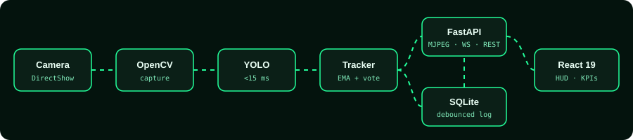
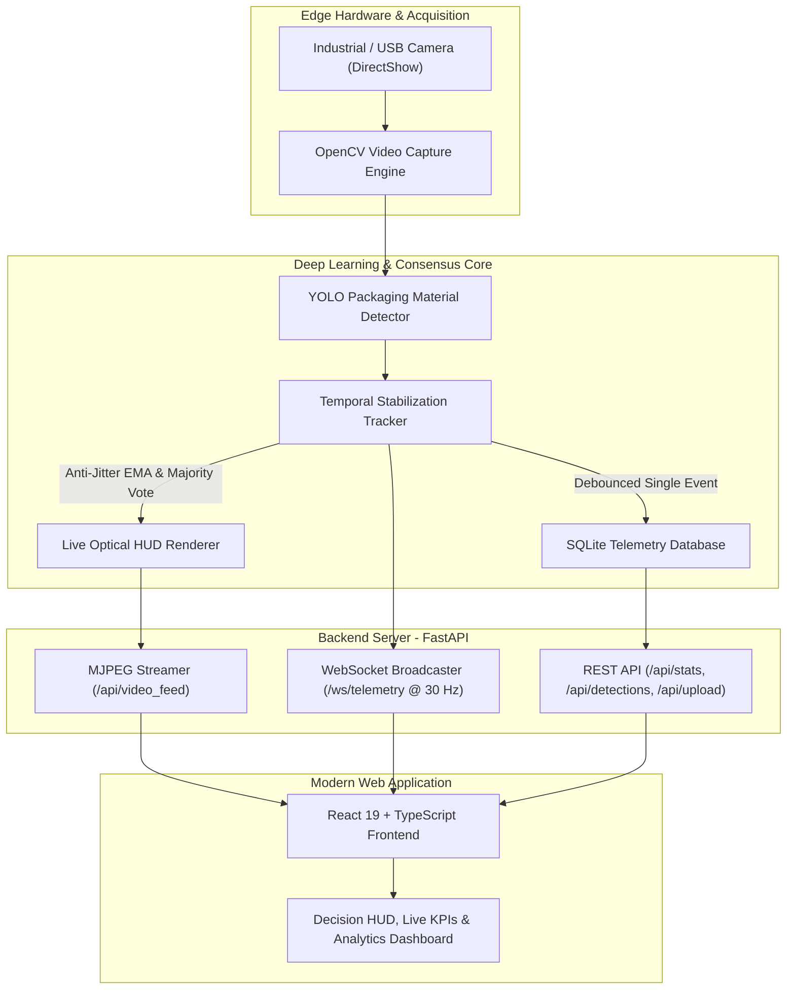
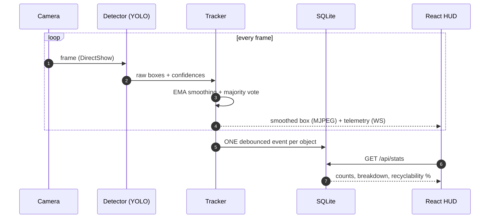

<div align="center">



<a href="https://git.io/typing-svg"></a>

[](https://www.python.org/)
[](https://fastapi.tiangolo.com/)
[](https://react.dev/)
[](https://www.typescriptlang.org/)
[](https://tailwindcss.com/)
[](https://docs.ultralytics.com/)
[](https://www.sqlite.org/)
[](#testing)
[](#license)

**[Quick Start](#quick-start)** •
**[How It Works](#how-it-works)** •
**[Taxonomy](#sorting-taxonomy)** •
**[API](#api-reference)** •
**[Dev Mode](#development-mode)** •
**[Testing](#testing)** •
**[Troubleshooting](#troubleshooting)**

</div>

---

## At a Glance

<div align="center">

| Inference | Telemetry | Classes | Model size | Cloud needed |
| :---: | :---: | :---: | :---: | :---: |
| **< 15 ms** | **60 FPS** HUD · **30 Hz** WebSocket | **6** materials | **5.5 MB** | **None** |

</div>

**EcoVision ST-04** is an edge-native, real-time computer vision platform for automated packaging inspection, material classification and selective sorting guidance. It combines Ultralytics YOLO localization, high-throughput OpenCV DirectShow capture and a decoupled React interface — all served from a single local port.

Typical prototype classifiers suffer from label flicker and camera lock-ups. EcoVision fixes both with an **EMA spatial smoothing filter** plus a **sliding-window consensus engine**: boxes glide, the UI never freezes when you swap paper for plastic, and each physical object is logged **once** in SQLite.

---

## How It Works

<div align="center">

</div>

<details open>
<summary><b>Full architecture diagram</b> (click to collapse)</summary>



</details>

<details>
<summary><b>One frame, step by step</b> (sequence diagram)</summary>



</details>

<details>
<summary><b>The stabilization math</b></summary>

**1. Spatial EMA** — every box coordinate is smoothed independently (α = 0.65):

```text
b̂ₜ = α · bₜ + (1 − α) · b̂ₜ₋₁        where b = (x1, y1, x2, y2)
```

**2. Sliding-window consensus** — the displayed class is the majority vote over the last *N* frames, which absorbs reflections and transient camera noise.

**3. Adaptive face / hand false-alarm suppression** — organic waste (`[ORGA]`) requires a confidence floor of **τ ≥ 0.68**, so faces and hands never trigger a compost alarm.

**4. Debounced logging** — a detection is committed to SQLite only after the consensus stabilizes, giving exactly one row per physical object.

</details>

### Key Capabilities

| Feature | Description |
| :--- | :--- |
| **Zero-freeze switching** | Bounding boxes update continuously while items are swapped in the inspection field |
| **Anti-jitter EMA** | Smooth, glued-to-object boxes at 60 FPS |
| **Majority-vote consensus** | Eliminates label flickering across consecutive frames |
| **Face-safe organics** | Confidence floor threshold τ ≥ 0.68 for biological class |
| **Single-port stack** | FastAPI serves REST, WebSocket **and** the compiled React bundle on `:8000` |
| **100% local** | Operates entirely on-device without internet access, subscription, or API key |

---

## Sorting Taxonomy

> Click a material to expand its sorting directive.

<details>
<summary><b><code>[CARD]</code> Cardboard / Tetra Pak</b> &rarr; Yellow Bin (Recyclable)</summary>

Flatten cartons and milk bricks. Deposit dry in the **Yellow Bin**.

</details>

<details>
<summary><b><code>[PLAS]</code> Plastics (PET, HDPE, Films)</b> &rarr; Yellow Bin (Recyclable)</summary>

Empty liquid. Keep cap screwed on. Deposit in the **Yellow Bin**.

</details>

<details>
<summary><b><code>[METL]</code> Metal (Cans, Foil, Tins)</b> &rarr; Yellow Bin (Recyclable)</summary>

Empty food cans and aluminum beverage cans. Deposit in the **Yellow Bin**.

</details>

<details>
<summary><b><code>[PAPR]</code> Paper (Magazines, Sheets)</b> &rarr; Yellow Bin (Recyclable)</summary>

Deposit clean and dry, without plastic wrapping, in the **Yellow Bin**.

</details>

<details>
<summary><b><code>[GLAS]</code> Glass (Bottles, Jars)</b> &rarr; Green Bin (Recyclable)</summary>

Remove metal caps (they go to the Yellow Bin). Deposit glass in the **Green Bin**.

</details>

<details>
<summary><b><code>[ORGA]</code> Biodegradable / Organics</b> &rarr; Brown Bin (Compostable)</summary>

Deposit food scraps and organic waste in the **Compost / Brown Bin**.

</details>

---

## Quick Start

> **Requirements:** Windows · Python 3.10+ · Node.js (only to rebuild the frontend) · a USB/industrial camera

### Option 1 — One-click launch (recommended)

```cmd
RUN_APP_WINDOWS.bat
```

The launcher will:

1. Verify the local virtual environment (`.venv`)
2. Confirm the compiled React bundle (`frontend/dist`)
3. Start the unified Uvicorn server on `0.0.0.0:8000`
4. Open **http://localhost:8000** in your browser

> First time? Run `SETUP_WINDOWS.bat` once to bootstrap the environment and dependencies.

### Option 2 — Manual

<details>
<summary><b>Step 1: Set up the virtual environment</b></summary>

```powershell
python -m venv .venv
.\.venv\Scripts\activate
python -m pip install -r requirements.txt
```

</details>

<details>
<summary><b>Step 2: Build the frontend</b> (first run or after modifications)</summary>

```powershell
cd frontend
npm install
npm run build
cd ..
```

</details>

<details>
<summary><b>Step 3: Run the production server</b></summary>

```powershell
.\.venv\Scripts\python.exe -m uvicorn server:app --host 0.0.0.0 --port 8000
```

Open **http://localhost:8000**.

</details>

---

## Development Mode

Hot-reload on both sides:

```powershell
# Terminal 1 — backend with auto-reload
.\.venv\Scripts\python.exe -m uvicorn server:app --reload --port 8000

# Terminal 2 — Vite dev server (proxies API + WebSocket to :8000)
cd frontend
npm run dev        # → http://localhost:3000
```

---

## API Reference

<details open>
<summary><b>Streaming and telemetry</b></summary>

| Protocol | Endpoint            | Description                                              |
| :------- | :------------------ | :------------------------------------------------------- |
| `GET`  | `/`               | Serves the production React SPA                          |
| `GET`  | `/api/status`     | System readiness, model metadata, camera state, taxonomy |
| `GET`  | `/api/video_feed` | Multipart MJPEG stream with HUD annotations              |
| `GET`  | `/api/telemetry`  | Active object, confidence, FPS, signal stability         |
| `WS`   | `/ws/telemetry`   | High-frequency telemetry stream (25–30 Hz)              |

</details>

<details>
<summary><b>Camera and configuration</b></summary>

| Protocol | Endpoint               | Description                                                        |
| :------- | :--------------------- | :----------------------------------------------------------------- |
| `POST` | `/api/camera/start`  | Engage the camera and begin acquisition                            |
| `POST` | `/api/camera/stop`   | Halt acquisition and release the device                            |
| `GET`  | `/api/camera/status` | Whether the capture device is active                               |
| `POST` | `/api/config`        | Update camera index, confidence threshold, auto-logging on the fly |

</details>

<details>
<summary><b>Data and analytics</b></summary>

| Protocol | Endpoint                  | Description                                     |
| :------- | :------------------------ | :---------------------------------------------- |
| `GET`  | `/api/detections`       | Recent confirmed detections                     |
| `GET`  | `/api/stats`            | Totals, material breakdown, recyclability %     |
| `GET`  | `/api/export-csv`       | Download the full registry as CSV               |
| `POST` | `/api/detections/clear` | Purge all logged detections                     |
| `POST` | `/api/upload`           | Single-shot YOLO inference on an uploaded image |

</details>

<details>
<summary><b>Try it from your terminal</b></summary>

```powershell
# Start the camera
curl -X POST http://localhost:8000/api/camera/start

# Raise the confidence threshold
curl -X POST http://localhost:8000/api/config -H "Content-Type: application/json" -d "{\"confidence\": 0.6}"

# Live KPIs
curl http://localhost:8000/api/stats

# Classify a single image
curl -X POST http://localhost:8000/api/upload -F "file=@bottle.jpg"
```

> Field names in the `/api/config` body may differ — check `server.py` for the exact schema.

```javascript
// Subscribe to live telemetry from the browser console
const ws = new WebSocket("ws://localhost:8000/ws/telemetry");
ws.onmessage = (e) => console.log(JSON.parse(e.data));
```

</details>

---

## Testing

The suite validates SQLite transactions, taxonomy integrity, color conversion and tracker stabilization — **no camera required**.

```powershell
.\.venv\Scripts\python.exe -m pytest tests/ -v
```

<details>
<summary><b>Expected output (9 passed)</b></summary>

```text
tests/test_database.py::test_init_db PASSED                       [ 11%]
tests/test_database.py::test_log_and_get_recent_detections PASSED [ 22%]
tests/test_database.py::test_statistics_summary PASSED            [ 33%]
tests/test_database.py::test_dataframe_export PASSED              [ 44%]
tests/test_database.py::test_clear_database PASSED                [ 55%]
tests/test_detector.py::test_taxonomy_mappings PASSED             [ 66%]
tests/test_detector.py::test_hex_to_bgr PASSED                    [ 77%]
tests/test_detector.py::test_tracker_realtime_stabilization PASSED[ 88%]
tests/test_detector.py::test_detector_inference PASSED            [100%]

============================== 9 passed in 4.70s ==============================
```

</details>

---

## Repository Structure

<details>
<summary><b>Click to explore the tree</b></summary>

```text
camera_trashnet_yolo/
├── assets/                     # Animated SVGs used by this README
├── .streamlit/config.toml      # Streamlit styling parameters
├── data/
│   ├── snapshots/              # Snapshot capture directory
│   ├── dataset_summary.json    # Dataset distribution metadata
│   ├── README_DATASET_FR.md    # Dataset license & documentation
│   └── waste_data.db           # SQLite store (auto-initialized)
├── frontend/                   # React + Vite + TypeScript app
│   ├── src/
│   │   ├── components/         # Live, Upload, Analytics, Settings
│   │   ├── App.tsx
│   │   ├── index.css           # Tailwind v4 styling
│   │   └── types.ts
│   ├── package.json
│   └── vite.config.ts          # Build pipeline & proxy rules
├── pages/1_Analytics.py        # Streamlit analytics fallback
├── src/
│   ├── camera.py               # DirectShow OpenCV context manager
│   ├── config.py               # Taxonomy, thresholds, paths
│   ├── database.py             # Thread-safe SQLite + analytics
│   ├── detector.py             # YOLO inference + HUD renderer
│   └── tracker.py              # EMA smoothing + debounced events
├── tests/
│   ├── test_database.py
│   └── test_detector.py
├── weights/waste_material_detector_best.pt   # 6-class YOLO model (5.5 MB)
├── server.py                   # FastAPI app (REST + WS + MJPEG + SPA)
├── app.py                      # Standalone Streamlit app
├── ARCHITECTURE.md             # In-depth architectural blueprint
├── requirements.txt
├── RUN_APP_WINDOWS.bat         # One-click launcher
└── SETUP_WINDOWS.bat           # Environment bootstrap
```

</details>

---

## Troubleshooting

<details>
<summary><b>Camera does not start / black frame</b></summary>

- Close any app already using the camera (Teams, Zoom, browser tabs).
- Change the camera index via `POST /api/config` (try `0`, `1`, `2`).
- Make sure the device is exposed through DirectShow on Windows.

</details>

<details>
<summary><b>Blank page at localhost:8000</b></summary>

The React bundle is missing. Run `cd frontend && npm install && npm run build`, then relaunch.

</details>

<details>
<summary><b>Hands or faces trigger "organic"</b></summary>

Raise the confidence threshold with `POST /api/config`. The built-in floor for `[ORGA]` is already τ ≥ 0.68.

</details>

<details>
<summary><b>Port 8000 already in use</b></summary>

Start Uvicorn with another port (`--port 8001`) and update the Vite proxy in `frontend/vite.config.ts` if you use dev mode.

</details>

---

## Roadmap

- [X] Real-time YOLO detection with EMA + consensus
- [X] Single-port FastAPI + React production bundle
- [X] SQLite logging, CSV export, analytics dashboard
- [ ] Multi-camera support
- [ ] Linux / macOS launchers
- [ ] Docker image
- [ ] Hardware actuator output (sorting gate / servo)
- [ ] Model versioning and in-app retraining feedback loop

---

## Contributing

1. Fork the repo and create a branch: `git checkout -b feat/my-feature`
2. Run the tests: `python -m pytest tests/ -v`
3. Open a pull request with a clear description

---

## License

Released under the **MIT License** — see [LICENSE](LICENSE).

<div align="center">
